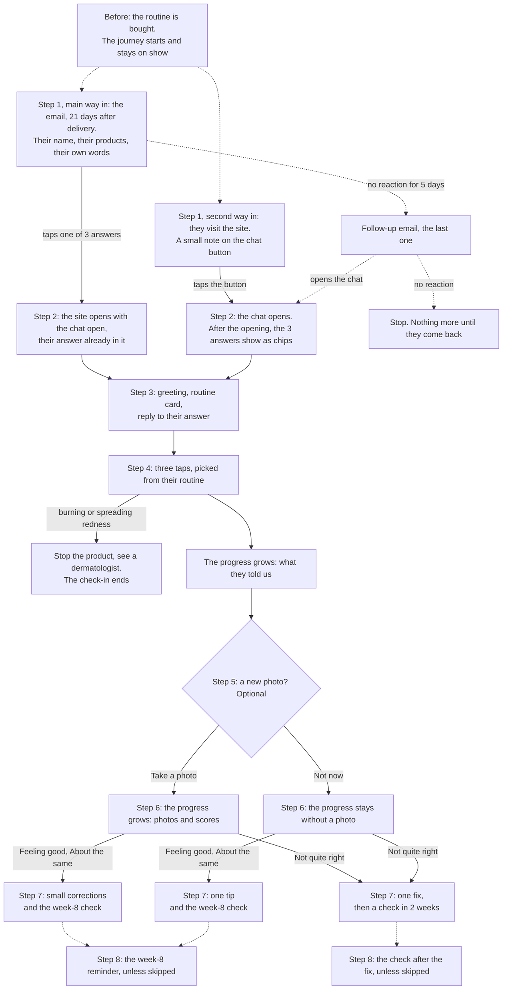

# The week-3 return: user flow

> Working notes. The start page and the prototype are the final version.

The solution for the main return path. A shopper did a skin analysis in a brand's chat, bought a routine, and comes back in week 3 of using it. This file covers the way in, the return to the chat, the progress view, the next step and the messages after. The build plan is made from it.

How to read it:
- Text in quotes is working copy. The meaning is fixed, the wording can still change.
- **(scripted)**: made-up data for the prototype.
- **(assumption)**: something the flow relies on without proof. All are listed in section 10.
- Brackets name the source: one of our research docs, a study or a review. "Our call" and "our reading" mean it's ours, not from research.
- Section 12 lists the edge cases we keep simple, and what isn't confirmed yet.

## 1. The idea

- At week 3, little visible change is normal. The whole path is built on that.
- So the return doesn't offer results. It answers the doubt: "Am I on track, and is it worth going on?"
- "No change" means on track. It's the main path, not an error state.
- Progress is a journey that is always on show. It starts when the routine is bought, and week 3 is the first checkpoint on it.
- Everything is built from the shopper's own data: their name, their products, their words, their dates. No general scripts.
- The promise, in one line: "See if you're on track, and fix what isn't."
- Our goal is to show we care and to handle the doubt. Nothing is sold at week 3.

## 2. The shopper and what the chat knows

### The data (scripted)

| What | Value | Where it comes from |
|---|---|---|
| Name | Maya | The order (assumption) |
| Concern | Dryness and texture | The first analysis |
| Bought in the chat | Hydrating Serum, Gentle Retinol Night Cream | Brief: 2 of 3 bought |
| Not bought | Cleanser | Brief: 1 of 3 not bought |
| What they said last time | "My skin feels tight by evening" | Brief: the chat remembers the last conversation |
| How they live | Sleeps and eats well, does yoga, not much stress lately | Their first message (assumption). "What else has changed lately?" asks against it |
| What the chat said last time | Hydration first, texture around week 8 | The "journey started" card (section 5) |
| Starting scores | Hydration 62, Texture 64, Redness 87 | The first analysis. Out of 100, higher is better (skin.chat reference) |

Why this scenario: hydration can change in 1–2 weeks, so there's an honest early win. Texture takes 6–8 weeks, so it's the week-8 goal. Retinol often irritates in weeks 2–4, so "Not quite right" is believable (user research; Perfect Corp, vendor).

### The catalog (scripted)

How to use each product. Made up for our made-up brand. In the prototype it reads as the brand's own directions.

| Product | When | Order |
|---|---|---|
| Hydrating Serum | Morning and evening | On clean skin, before the cream |
| Gentle Retinol Night Cream | Evening only | Last, after the serum |

### The days (scripted)

| Day | What happens |
|---|---|
| −3 | The skin analysis and the purchase, in the chat. The journey starts |
| 0 | The order arrives. Week 1 of the routine starts. Delivery takes "a few days"; we script 3 |
| 21 | The week-3 email goes out. The note on the chat button starts to show. The prototype plays on this day |
| 26 | The follow-up email, only if there was no reaction |
| About 35 | The check after a fix, only for "Not quite right" |
| 56 | The week-8 check |

### Two clocks

- The routine counts from delivery. The chat says "week 3 of your routine", never "3 weeks since your analysis".
- The scores compare with the first analysis.
- Why from delivery: doubt and irritation peak in weeks 2–4 of use (user research). Counted from the analysis, a week of delivery would make it week 2 of use, which is too early.
- The brief counts 3 weeks from the analysis. We send 3 weeks after delivery, so the analysis is a few days older. A small stretch of the brief's scenario (assumption).
- "Of about 8" comes from their concern, texture. Another concern gives another number.

### Personal at every step

Each step is built from this data, not from a general script (ideas.md).

| Where | What's personal |
|---|---|
| The "journey started" card | Their name. Milestones from their own concerns. Their own dates |
| The journey bar | "Maya's journey · week 3 of about 8" |
| The email | "Hi Maya", their products by name, their own words. No scores, no photo |
| The note on the chat button | Their week. No name: the note shows on the site before they open the chat |
| The opening | "Hi Maya", their routine, what the chat told them, what they said |
| The questions | Picked from their concern and their products: dryness gives the question about tightness, retinol the one about stinging |
| The progress view | Their name in the headline, their words then and now, their photos. Compared only with their own start |
| The next step | The corrections and the fix name their products and quote their answers. Their own date for week 8 |
| The timing | The email day comes from their delivery. A refill heads-up comes from each product |

## 3. The flow at a glance

The diagram shows the whole flow. The prototype plays only "About the same", the "nothing changed" case, always with a photo. "Feeling good" and "Not quite right" are described, not played. "Not now" is described, not built.

### What differs by answer

The three answers share one flow. Only these parts differ.

| | Feeling good | About the same (main path) | Not quite right |
|---|---|---|---|
| How common | Unknown | Our guess: about 80%. No data | Unknown |
| The chat's reply | "Good to hear. When we started, I said hydration first, texture around week 8. Let's check hydration." | "Let's check how your skin is doing." No verdict yet: "going as planned" comes at the end, after the questions and the photo (step 7) | "Thanks for telling me. Let's find out what's going on." A tip follows later, not only sympathy |
| Questions | How it feels, any stinging, how they use it | How it feels, any stinging, how they use it | What feels off, what else changed, how they use it |
| Why a photo | "To see it side by side and track your progress." | "Just to check if you need small corrections." | "Want to compare a photo with 3 weeks ago? It can show if redness went up." |
| The brief's state it shows | Scores got worse, slightly | Nothing changed | Scores got worse, clearly |
| Next step, with a photo | Small corrections and the week-8 check | Small corrections and the week-8 check | One fix, a check in about 2 weeks |
| Next step, no photo | Suggestions and the week-8 check | Suggestions and the week-8 check | One fix, a check in about 2 weeks |

### Photo results (scripted)

One result per answer, so "nothing changed" and "scores got worse" are both shown.

| | Hydration | Texture | Redness |
|---|---|---|---|
| Start | 62 | 64 | 87 |
| Feeling good | 71: up | 62: a slight dip, normal variation | Not scripted |
| About the same | 64: no real change | 63: no real change | 86: no real change |
| Not quite right | 68: a little up | 63: no real change | 72: clearly more redness |

A higher score is better, so more redness is a lower Redness score.

### The prototype's path (scripted)

One ending is played: "About the same", always with a photo. "Feeling good" and "Not quite right" are shown in the email and the chat, but a tap says "Not in this demo." They're described in the rationale. Their columns below are the script for that description. Each question has one scripted answer. The other chips and "Not now" are shown, but not played.

| | Feeling good | About the same | Not quite right |
|---|---|---|---|
| Question 1 | "Less tight" | "The same" | "More redness" |
| Question 2 | "None" | "None" | "Nothing new" |
| Question 3 | "The same" | "The same" | "Every night" |
| The photo | "Take a photo" | "Take a photo" | "Take a photo". The photo check is answered "yes" |
| Progress state | C | B | D |
| Ends with | "You're on track" with the week-8 check. After "Yes, take a photo" it also has the photos, scores and small corrections | The same | One fix, then the check in 2 weeks |

The states are in step 6.

## 4. Screens and parts

### Screens

| Screen | What it is | Details |
|---|---|---|
| The email | The week-3 email, as it looks on a phone | Step 1 |
| The brand page | A plain page of the brand's site with the chat button and its note. No shop is designed | Steps 1 and 2 |
| The chat | A sheet over the brand page. Steps 2 to 7 happen here | Steps 2–7 |
| The full progress view | Opens over the chat | Step 6 |
| "About this prototype" | A small sheet outside the phone flow: what a brand changes and what's fixed | Section 8 |

### Parts used in more than one place

| Part | What it is | Where it shows | Details |
|---|---|---|---|
| Journey timeline | Start · week 3 check-in · week 8, with "you are here" | The "journey started" card, every email, the short card after the questions, the full view | Section 5 |
| Journey bar | One slim line that never scrolls away | The top of the chat | Section 5 |
| "Journey started" card | The last card of the first visit | The old conversation, above the new visit | Section 5 |
| New-visit divider | A small line between the old conversation and the new visit | The chat | Step 2 |
| Routine card | What the chat knows about their routine, and a way to correct it | The opening, the full view | Step 3 |
| Answer chips | One-tap answers | Every question in the chat | Step 4 |
| Short progress card | What's new, with a "See my progress" button | After the questions, after the photo | Steps 4 and 6 |
| Next-check message | The date of the next check, the timeline with week 3 checked, and "Don't remind me" | The end of the chat | Step 7 |
| Note on the chat button | A small message from the button | The brand page | Step 1 |

## 5. The journey: progress, always on show

### It starts when the routine is bought

The first visit ends with a "journey started" card. The first visit is out of scope, so this card is the only part of it we design. At week 3 it's the last card of the old conversation, just above the new visit.

| Part of the card | Working copy |
|---|---|
| Opening | "Maya, your routine is on its way. This is where your journey starts." |
| What to expect, from their own concerns | "For dryness: hydration and comfort usually come first, in the first weeks. For texture: it usually starts to show around week 8." |
| Timeline | Start · week 3 check-in · week 8, with the start marked. Their own dates appear once the order arrives |
| When it starts counting | "Week 1 starts when your order arrives." (our reading of the two clocks) |
| The promise | "I'll check in with you at week 3." This is where they agree to the emails. A specific promise wins the opt-in (competitor research, vendor case studies) |

- What the card can promise: hydration and comfort can change in 1–2 weeks, texture in 6–8 (Perfect Corp, vendor). The card doesn't say that most people feel better by week 3. Our research doesn't show that.
- Why set expectations: 77% would value an AI tool that shows what results to expect (Harris Poll). Then week 3 checks against what was said, not against hope.

### The timeline

- Three points: the start, the week-3 check-in and week 8. It marks where they are now.
- The milestones are their own concerns. For dryness: hydration and comfort, in the first weeks. For texture: around week 8, with their own date.
- For another shopper, the milestones and the last week come from their concerns and from the catalog (assumption).

### Where it's always seen

1. **Pinned at the top of the chat.** A slim bar that never scrolls away. A tap opens the full progress view.
2. **In every email.** The same small timeline at the top of each message.
3. **In Skin Portrait.** The full view lives there. Today skin.chat keeps past analyses there, side by side, with no comparison (skin.chat reference). In the prototype, the Skin Portrait chip in the chat's header opens the full view.

Not on the chat button. The button carries only a note about the check-in (step 1).

### What the bar says

| Moment | The bar |
|---|---|
| Bought, not delivered yet | "Maya's journey · starts when your order arrives" |
| Week 3, before the check-in is finished | "Maya's journey · week 3 of about 8" |
| After the check-in, "Feeling good" or "About the same" | "Maya's journey · week 3 of about 8 · next check at week 8" |
| After the check-in, "Not quite right" with a fix | "Maya's journey · week 3 of about 8 · next check in 2 weeks" |

### It grows each time they add something

When they answer about how the skin feels, or take a photo, the chat shows a short card with what's new and a "See my progress" button. The bar and the full view update at the same moment.

## 6. Step by step

### Step 1. The way in

**Main: the week-3 email**

- Who gets it: shoppers who agreed to email at the first visit (assumption), haven't opted out or paused, and haven't started the check-in on the site.
- When: 21 days after delivery, so it's week 3 of actual use.
- Why email: they check progress in the mirror and won't open the chat on their own. WhatsApp only if they opted in; it's on the short list.
- Why not an email with tips alone: it could work, but it's weaker and doesn't bring them back to the chat (our call).

| Part | Working copy |
|---|---|
| From | The brand, signed as its skin advisor. Shoppers know the assistant as the brand's (ideas.md) |
| Subject | "Week 3: how's your skin?" No name in the subject |
| Timeline | The small journey timeline: "Maya's journey · week 3 of about 8" |
| Greeting | "Hi Maya." |
| Their products | "You've had your Hydrating Serum and Night Cream for three weeks." |
| Their own words | "When we started, you told me your skin felt tight by evening." It also says where the chat knows it from |
| Question | "How is your skin feeling now?" |
| What they get | "See if you're on track, and fix what isn't." |
| Three buttons | "Feeling good" · "About the same" · "Not quite right" |
| Footer | Why they get this email · "Pause" · "Unsubscribe" |

- Each button is a link that opens the chat with that answer.
- Not in the email: scores, photos, a photo ask, products to buy, a discount, a promise of results, "we miss you". Skin data stays in the chat.
- Why it looks like this:
  - It asks about their skin, not about using the products. Plain reminders didn't help in small trials; being asked about their own skin did (user research).
  - The ask is tiny, with no selfie. "I don't know if I'll bother" (Mumsnet).
  - The line above the buttons says what they get. Without it the email reads like a survey (Musely review, App Store).
  - The answers are soft, so we don't name problems before they do. No research on buttons against a slider (our call).
  - Their own words make it a personal check-in, not a mailing. A personal check-in "feels way more personal than I expected"; an automated one read as "a quick satisfaction survey" (App Store reviews).

**Second: the chat button on the site**

The brief's chat opens from a button on any page. A shopper who comes to the site in week 3 without the email gets the same check-in from there.

- What they see: a small note from the chat button, on any page. It sits inside the widget, not in the brand's layout, so it needs no custom work per brand (ideas.md).
- What it says: the same promise as the email. "Week 3 of your routine: see if you're on track." Value tied to them, not "chat with us" (ideas.md). No name: the note shows on the site before they open the chat.
- Who sees it: a shopper the chat recognises (assumption), from day 21 until they finish the check-in. Without login that means the same browser (ideas.md).
- How often: once per visit. If they close it, it stays hidden until the next moment worth mentioning (ideas.md).
- No marketing consent needed: they came on their own (our reading). So it also reaches shoppers who never agreed to emails.
- A tap on the note or on the button opens the chat. After the opening (step 3), the chat asks "How is your skin feeling after 3 weeks?" with the three answers as chips.
- A check-in started here replaces the week-3 email. The next email is the week-8 one.

### Step 2. Back on the brand's site

- The email link opens a plain page of the brand's site with the chat already open as a sheet over it. Mobile only. No shop is designed: the brief only says the chat is a widget on the brand's site.
- The chat recognises them from the link, even in another browser (assumption). Haut.AI's docs say a brand can pass its customer ID (reference/brands).
- The journey bar is pinned at the top: "Maya's journey · week 3 of about 8".
- The thread, top to bottom:
  1. The first visit, ending with the "journey started" card. In the prototype only this card is shown.
  2. A small divider that marks the new visit. Today skin.chat adds new messages under the old ones with no sign that time has passed (skin.chat reference).
  3. Their answer from the email, as their own message.
  4. The opening (step 3).
- When they close the chat, the button stays on the page. They can open the chat again where they left off.

### Step 3. The opening

Three things in this order, before any question:

1. **A greeting.** "Hi Maya. It's week 3 of your routine."
2. **The routine card.** It shows we remember them.
3. **A reply to their answer**, then on to the point (the replies are in section 3). The reply quotes the "journey started" card back ("When we started, I said hydration first…") and uses what they said ("you mentioned your skin feels tight by evening").

In the prototype, the chat checks what it remembers before going on: "Your request", "Your lifestyle" ("Good sleep and food, yoga, and no strong stress lately."), "Current routine" and the timeline, then "Is everything correct?" with "Yes, that's correct" · "I use a different routine" · "No, I'll tell you". Only "Yes" is played. The timeline under the routine card is titled "Third week of the routine". At the end of the first visit, the same timeline is titled "First week of the routine".

From the chat button there's no answer yet. So after the routine card the chat asks "How is your skin feeling after 3 weeks?" with the three chips, and replies once they tap.

**The routine card**

| Part | Content |
|---|---|
| Title | "Your routine · week 3 of about 8", with the day it started |
| Bought, row 1 | Hydrating Serum |
| Bought, row 2 | Gentle Retinol Night Cream |
| Not bought | "Cleanser: using your own?" A tap gives "I have my own" and "Not using one". No pitch |
| Where they started | Hydration 62, Texture 64, with the date of the analysis |
| Where it comes from | One quiet line: "From your skin analysis and your order." Memory without a reason feels creepy (ideas.md) |
| Button | "Update my routine". For each product: "Using it", "Haven't started" or "Stopped". Plus "Add a product from another brand" |

- The chat never asks what it already knows. Being asked again makes people angry (4 App Store reviews).
- The chat doesn't ask what they use in a separate message. The card shows it, and they can correct it. Routines are mixed from many sources (informal talks). It's to understand their case, not to sell.
- The same card comes back in the full progress view.
- In the prototype, "Update my routine" opens and updates the card. What the chat changes after "Haven't started" or "Stopped" is not built.

### Step 4. Three taps

- Answers are chips, one tap each.
- The questions are picked from their own data: the concern picks the question about feel, the products pick the rest. Another shopper gets other questions. Personal, not a survey (Musely review, App Store).

**"Feeling good" and "About the same": 3 questions**

Tightness isn't asked again. The opening question already quotes it ("you told me your skin felt tight by evening. How is your skin feeling now?"), so their answer to it is the answer about tightness. Asking twice makes people angry (step 3).

- After "Feeling good" the chat first says what it means: "That's hydration starting to show. It usually comes first." This is the small win they missed.
- After "About the same" it goes straight to the questions.

Every question ends with "I don't know", so nobody has to guess. The chat says that's fine and goes on to the next question. Shown, not played.

1. New spots, tied to their products: "Any new spots since you started?" New actives like retinol can bring spots in weeks 2–4 (user research). "Spots", not "breakouts", which reads as jargon (our call).
   - "None" · "A few" · "More than usual" · "I don't know".
   - "None" (the prototype's path): no reply of its own. The reply after the next question covers both.
   - "A few": the chat says a few spots can come with a new active in the first weeks, and that it will ask again at the next check. It doesn't call it "purging": that's contested (user research). Then it goes on.
   - "More than usual": the chat moves to the "Not quite right" questions.
2. Any irritation, tied to their products: "Any stinging from the Night Cream?" Retinol often irritates in weeks 2–4 (user research), so this routine gets the question.
   - "None" (the prototype's path): "Good. Your skin takes it well."
   - "A little, now and then": the chat says mild early irritation is expected and that spacing out use helps (Iberian dermatology consensus). Then it goes on.
   - "Yes, most times": the chat moves to the "Not quite right" questions.
3. The other thing they said at the first visit, tied to their concern: "You also said your skin looks a bit rough. How is it now?"
   - "Smoother" · "The same" · "Rougher" · "I don't know".
   - "The same" (the prototype's path, in both branches): no reply. Texture takes until about week 8 (Perfect Corp, vendor), so "the same" is the expected answer at week 3.
   - It replaces "How often do you get to the Night Cream?": all three questions are about their skin.

**"Not quite right": 3 questions**

The chat finds the reason before it advises. It rules out obvious causes first, in their own check and in our analysis.

1. What feels off: "A bit of stinging" · "Dry or flaky" · "More redness" · "New spots" · "It burns, or the redness is spreading".
   - The last one ends the check-in: "Stop the night cream for now. Burning or spreading redness is something a dermatologist should look at." The chat stays open for questions. No fix is given and no check is booked, so nothing more is sent.
2. What else changed: "Another new product" · "Colder weather or heating" · "Stress or little sleep" · "Nothing new".
   - Something new in the mix can be the cause: dermatologists advise no more than one new product every 2 weeks (NewBeauty).
   - It lets the chat say "this may be the weather, not the routine" (ideas.md).
3. How they use it: "How often do you use the night cream?" The chips are the same as above.

- The prototype's path: "More redness" → "Nothing new" → "Every night".
- The order when something is worse: photo conditions, then stinging or dryness, then season or stress, then how they use it (user research). Here the check of the photo conditions comes later, in step 6, because the photo is optional and comes after the questions (our reading).

**After the questions, the progress grows**

The chat shows a short card. It answers "am I on track?" before the photo is asked for. The bar and the full view update too.

In the prototype: after the last answer, about 4 seconds of skin.chat's own "Figuring out…" (its line while it works, with a light passing over it), then a plain message: "It looks like everything is going as planned. Skin changes slowly, so feeling about the same at week 3 is normal. But I'd suggest taking a photo to check if you need any small corrections." and "Take a photo?" Two answer rows, as the questions above, both played: "Yes, take a photo" and "No, that's all for now". Both lead to the "You're on track" message (step 7).

| Part of the card | "Feeling good" and "About the same" | "Not quite right" |
|---|---|---|
| Timeline | "Week 3 of about 8", with "you are here" | The same |
| What they told us | "Tight by evening → less tight" · "No new spots" · "No stinging" | "More redness" · "Nothing else new" · "Night Cream every night" |
| Button | "See my progress" | "See my progress" |

### Step 5. The photo, optional

- Offered after the questions, in every branch, each with its own reason (section 3). Never required.
- Before the photo, one tip: the same light as last time, no make-up (Perfect Corp, vendor).
- Buttons: "Take a photo" · "Not now".
- "Take a photo": one tap, a short "analysing…", then the result with a sample face, not a real person's photo. The capture flow is out of scope.
- "Not now": the chat goes on without a photo and doesn't ask again in this visit. People can skip the photo and still get help (ideas.md). Described, not built.
- Week 8 stays the main comparison. The week-3 photo gives it a closer point to compare with.

### Step 6. The progress view

**Where it shows**

- After a photo, the chat shows a short card: the headline, the two photos and a "See my progress" button.
- The button opens the full view over the chat.
- The same full view opens from the journey bar and from Skin Portrait.

**The full view, top to bottom**

A diary of their journey, not a scoreboard.

| # | Part | Content | Shown |
|---|---|---|---|
| 1 | Headline | One honest sentence. It changes with the state (below) | Always |
| 2 | Timeline | "Week 3 of about 8", with "you are here". Behind: hydration and comfort, for their dryness, in the first weeks. Ahead: "texture usually shows around week 8", with their own date | Always |
| 3 | What you told me | Then and now, in their words: "tight by evening → less tight" | Always. "Now" appears once they answer |
| 4 | Photos | Then and now, side by side | Only with a new photo |
| 5 | Scores | Where they started, and now | The start always. "Now" only with a new photo |
| 6 | The routine card | The same as in step 3 | Always |

**Score rules**

- Never hide a result. It's a matter of trust.
- Compare only with their own start, never with an average (ideas.md).
- Words first, numbers second. In skin.chat a higher score is better, so a bare "redness 72" reads the wrong way.
- Small moves are shown as normal variation, not as a win or a loss. In the prototype the line is 5 points (placeholder). In a test, repeat scans were mostly stable and 4 of 30 moved 5 or more points (Which?). The real line needs Haut.AI's own data (assumption).
- Order: what improved or held steady first, then what got worse (ideas.md).
- Describe, don't judge: "a bit more redness on the cheeks", not "problem areas" (ideas.md).
- Show the scores of their concern, and any other score that really moved. So Redness shows only in the "Not quite right" result. The rest sit behind "Show all 16". In the prototype the link is shown and the list isn't built.
- A flat dark-spot score isn't reported as "no change": scanners often miss dark spots (Which?).
- No game, streak or points. No simulated "after" face. No red heatmap over the whole face.
- A "Something looks wrong?" link lets them correct a misread (ideas.md). Described, not built.

How a score line reads:

| The move | The line |
|---|---|
| Better by 5 points or more | "Hydration: better than before (62 → 71)" |
| Less than 5 points either way | "Texture: about the same (64 → 62)" |
| Worse by 5 points or more | "Redness: more than before (87 → 72)" |

**The states**

| State | When | Headline | What the chat says next | In the prototype |
|---|---|---|---|---|
| A. No new photo | "Not now" in step 5 | "Maya, you're on track by how your skin feels. Week 3 of about 8." | Straight to the next step. The scores show only where they started | Described |
| B. Nothing changed | "About the same" with a photo | "Maya, you're on track. No real change in the scores yet, and at week 3 that's expected." | "All good. Here are a few small corrections." | Built |
| C. Better, one score slightly down | "Feeling good" with a photo | "Maya, your hydration is up. That's the first change we expected." | "Texture is 2 points lower. That's a normal difference between two photos, not a step back. Texture needs until about week 8." | Built |
| D. Clearly worse | "Not quite right" with a photo | "Maya, your hydration is a little up. Redness is higher than 3 weeks ago, so let's deal with that." | First the photo check: "Was this in similar light, without make-up?" If yes, on to the fix. If not: "Then let's not read much into the numbers", with a retake offered | Built, with the answer "yes" |

Before the photo, the full view shows what's known so far: the timeline, what they told us, the starting scores and the routine card. Its headline is the week: "Maya, you're at week 3 of about 8."

**How the chat reads a result**

- The reply depends on the week, what they said and what they use. The same scores at week 3 and at week 8 get different replies. There is no fixed reply per scan: scripted replies hurt trust (Curology reviews, Trustpilot).
- It points out what got better first, even if it's small.
- It stays calm about a small dip, and explains it.
- It works with a clear drop: it checks the photo conditions, then goes to the "Not quite right" questions and a fix. It doesn't brush it off.
- When the scores show nothing and they still feel something's off: "The scores don't show it, but what you feel counts."

### Step 7. The next step

**"Feeling good" and "About the same"**

Two main things: the small corrections and the week-8 check.

**Before the photo: a plain message.** After the questions and a moment of "Figuring out…", the chat says how it looks and offers the photo: "It looks like everything is going as planned. Skin changes slowly, so feeling about the same at week 3 is normal. But I'd suggest taking a photo to check if you need any small corrections." Then "Take a photo?" with two answer rows, as the questions above: "Yes, take a photo" · "No, that's all for now". "Going as planned" even when nothing has changed is from the solution draft ("if nothing much has changed, it means everything is going as planned").

**"You're on track", after "No, that's all for now" and a shorter moment of "Figuring out…" (about 2 seconds).** One message, from their answers, not a photo (solution draft: "a reminder to keep on track").

- Title, in skin.chat's big message title: "You're on track".
- A line to cheer them up: "Well done, Maya! Three weeks with a new routine is no small thing."
- Why, from their answers. "About the same": "Your skin feels about the same, and at week 3 that's a good sign: skin changes slowly, building the base first." "Feeling good" starts with "Your skin feels less tight, and that's how change usually starts" instead.
- "Suggestions" (item 2 below), as a small title with bullets.
- Every small title ("Suggestions", "A few small corrections", "What to expect", "Next check") is skin.chat's subtitle in a message, on its own line, with the same space under it.
- "What to expect", quoting the first visit back: "Hydration and comfort usually come first. Texture takes longer."
- The next check (item 3 below): the date, the timeline with week 3 getting its check, and a small "Don't remind me".
- Last line: "You can take a photo any time, just to check if you need small corrections." Then one "Take a photo" pill, as skin.chat's "Scan my face". It leads to the same photo step.

**After "Yes, take a photo" (or the pill):** "Analysing…", then the same "You're on track" message, with these differences:

- After the explanation: the two photos side by side and the scores, as skin.chat's fact cards ("Hydration · About the same · 62 → 64").
- "Feeling good" adds one line on the slight dip in texture: a normal difference between two photos.
- "A few small corrections" in place of "Suggestions", with the corrections as bullets (skin.chat's own bullet list).
- No "You can take a photo any time" and no "Take a photo" pill.

**After "No, that's all for now", then the "Take a photo" pill:** "Analysing…", then a short follow-up, not the whole message again. "You're on track", "What to expect" and the next check are already just above.

- Title, in skin.chat's big message title: "Still on track".
- One line on the scores. "About the same": "No real change in the scores yet, and at week 3 that's expected." "Feeling good": "Your hydration is up. That's the first change we expected."
- The two photos side by side and the scores. "Feeling good" adds the line on the slight dip in texture.
- "A few small corrections", with two: the ones "Suggestions" didn't give ("Try the Serum first…", "The Night Cream may affect texture…").

1. **Small corrections, only after a photo.** 3 at most, about the routine only, not the photo. They are the reason to take the photo at week 3. In the prototype:
   - "Try the Serum first, on clean skin, morning and evening." How to use it, from the catalog (section 2).
   - "The Night Cream may affect texture if you use it during the day. If so, use it in the evening only." Retinol goes in the evening (catalog).
   - "Winter is coming, so your skin might need extra moisture." Colder weather and heating are among the causes the chat asks about (step 4). Our reading, no source on the advice itself.
     - "moisture" is a link, where a link to products would go. In the prototype it only shows a note: "Our goal isn't to sell, but we can upsell gently." No pitch at week 3, but a gentle way in when there's a real reason.
   - A correction comes from the scan only when a change is bigger than normal variation. The others come from their answers.
2. **Without a photo: "Suggestions"**, from their answers only, as bullets:
   - "Your skin takes the Night Cream well. If you use it every other night, you can try it every night." From "No stinging". More often, not more product, and no promise of faster results. Building up retinol once it's tolerated is common dermatology advice, not from our research.
   - "Winter is coming, so your skin might need extra moisture." The same line and link as in the corrections.
3. **The week-8 check**, inside "You're on track", with their own date. "See you around week 8, when change usually starts to show." No promise of visible results.
   - The timeline under it: week 0 and week 3 checked, week 8 ahead. When it comes into view, week 3 fills with the brand colour and its check pops in, with one soft ring.
   - One small grey button, under "See you around week 8…" and above the timeline: "Don't remind me". The reminder comes from the brand, so there's no "Add to calendar". In the prototype it only shows a note: "This will help us understand if people are happy with our week 3 check."
4. **A refill heads-up**, only if a product is due in the next couple of weeks. One quiet line, no button and no extra message. Not in the prototype.
5. **Two quiet chips**: "How do I use them together?" · "Can I add another product?" Not in the prototype.

Not at week 3: a pitch for the cleanser, a reorder button, a discount. The cleanser comes up only if they ask, or at week 8 if the skin is calm. "Do less" comes up only if they ask, or at week 8. The season is mentioned only to explain a dip.

**"Not quite right"**

1. **One fix**, with the reason taken from their own answers, not a general reply (ideas.md). In the prototype: "You use the Night Cream every night and nothing else is new, so it's the most likely cause. Use it every other night for now. Keep the Serum as it is." This is a scripted example. Research only says that mild early irritation is expected and that spacing out use helps (Iberian dermatology consensus).
2. **Other options** behind one chip: use less of it · pause it to see if it's the cause · swap it.
3. **A check in about 2 weeks**: "I'll ask how it's going in two weeks." One small button: "Don't remind me". The week-8 check moves on from there. Why 2 weeks: retinoid adjustment takes 2–4 weeks (systematic review, 2025).
4. **One line on when to see a dermatologist**: burning or spreading redness. Not right away for anything milder (user research).

**The button**

- "Don't remind me" means the next message isn't sent. How many tap it is part of our metric (solution draft, "How we'd know it works"). In the prototype it only shows the note above.
- "Add to calendar" was dropped on 20 Nov: the brand sends the reminder, so the message stays light. It was a calendar file with an alert and a link back to the chat (ideas.md); nobody in skincare offers it (competitor research).

**When the check-in is finished**

It counts as finished when they reach this step. Our metric needs this line: the share of shoppers who got the week-3 email, finish the check-in and don't skip the week-8 check.

### Step 8. After the visit

| Message | When | Sent only if | In the prototype |
|---|---|---|---|
| Week-3 email | 21 days after delivery | Agreed to email, no opt-out or pause, no check-in started | Built |
| Follow-up, the last one | 5 days later | No reaction to the first email | Described |
| Check after a fix | About 2 weeks after the visit | "Not quite right", a fix given, not skipped | Described |
| Week-8 reminder | Around week 8 | They finished the week-3 check-in and didn't skip it | Described |

Every message carries the small journey timeline at the top.

**The follow-up email**

- It doesn't mention that they didn't reply.
- It says this is the last message and that we won't write again until they ask, so they don't have to unsubscribe.
- It leaves a couple of useful tips for their own products and says the chat is there any time. It isn't the first email again: 54% unsubscribe when a brand keeps pushing the same offer (Optimove, vendor).
- A link opens the chat. The chat then asks the question with the three chips, as from the chat button.
- Why 5 days: it keeps the follow-up inside the weeks 2–4 doubt window (user research). The exact number is our call.

**Stop rules**

- Each email gets one follow-up 5 days later, only if they ignore it. If they ignore the follow-up too, nothing more, not even week 8, until they come back on their own.
- If they check in, the next check comes (week 8), with the same rule. Any later email works the same way.
- Stop at once on opt-out. Apart from that, we never stop on our own.
- Every message offers "Pause" next to "Unsubscribe". 58% would welcome a pause (Optimove, vendor).
- A skipped reminder isn't sent.

## 7. Rules for every step

- Value first: every message gives something. No "we miss you", no guilt, no "you missed".
- Honest: no promise of visible change at week 3 (brief: skin changes slowly). Bad results are never hidden.
- No sale at week 3. 43% fear paid placement in AI advice (Harris Poll).
- Gentle: describe, don't judge. Never blame. 85% want AI to help them feel confident, not judged (Harris Poll).
- Feel first, numbers second. People judge by feel, and light can move a score more than 3 weeks of skincare (user research; Which?).
- A next step every time. "Sorry to hear that" alone made one shopper leave; tips made another "push through" (App Store reviews).
- The photo is always optional. Only 32% are comfortable sharing a selfie with an AI tool (Harris Poll).
- The journey is always on show: pinned in the chat, in every email, in Skin Portrait.
- Personal, from their own data. Every message uses their name, products, words, dates or scores. No general scripts: they hurt trust (Curology reviews, Trustpilot).
- The name sits in greetings and headlines only. Everywhere else it's "you".
- The chat says where it knows things from: "you told me", "from your order". Memory without a reason feels creepy (ideas.md), and only 38% are comfortable sharing past purchases with an AI tool (Harris Poll).
- The chat never guesses a need they didn't tell it. 79% would be uncomfortable with that (Harris Poll).
- They can see and correct what the chat remembers, with "Update my routine" (ideas.md).
- The chat never asks what it already knows (4 App Store reviews).
- The chat's "Ask anything" field stays available at every step. In the prototype only the chips are scripted.

## 8. Brand and look

**The brand**

- One made-up brand, Clearwell: calm and clinical, white and soft green, clean sans-serif type, a quiet expert tone. Not a copy of a real brand.
- A brand can change: colours, type, logo, tone of voice, catalog, refill timing per product.
- Fixed for every brand: the flow, the layout, the journey and the progress view logic, the stop rules, the honest handling of bad answers, the kindness rules, the warnings about irritation and clashes.
- From the catalog, with no design work (our reading): product names, how to use each one, and when its results can show.
- From the shopper's own data, with no design work: everything personal. Personalisation comes from data, not design, so it works for every brand (ideas.md).
- Where the prototype says this: a small "About this prototype" sheet outside the phone flow, listing what changes and what's fixed.

**A second brand, built last**

- A small switch to a second made-up brand: warm and friendly, cream and terracotta, rounded type, a chatty and caring tone.
- Colours, type, logo and tone change. The flow stays the same.
- The design uses brand settings from the start. The second brand is added only if time is left: the brief asks for one brand style.

**The look**

- The chat looks and feels like skin.chat. The base is in `reference/skin-chat`: the header with the Skin Portrait chip, dark bubbles for the shopper's messages, soft gradient chips, a round avatar, Inter type, round corners.
- skin.chat has one slot for the brand colour, black by default. That's the slot a brand changes (skin.chat reference).
- The brand settings should fit brands that look very different from each other. Two real ones are kept in `reference/brands` as a private check. No real brand appears in the prototype.

## 9. In the prototype, and not

The brief's limits apply: mobile first, opens on a phone by link, chat answers and scores are scripted, no real AI or backend, no Figma.

**Built**

- The email, the brand page with the chat sheet, the opening.
- The journey: the "journey started" card at the end of the old chat, the journey bar, the timeline in the email, the full view.
- One ending: "About the same" is played, always with a photo, to its next step. "Feeling good" and "Not quite right" are shown, but a tap says "Not in this demo."
- The photo step and progress state B. States C and D are described in the rationale, not played.
- "Update my routine", opening and updating the routine card.
- "Don't remind me" as a button.
- The second way in, as one screen: the brand page with the note on the chat button.
- The "About this prototype" sheet.
- No extra screens beyond these.

**How it plays**

- Only the main path is played: one scripted answer per question, then "Take a photo".
- The other chips and "Not now" are shown, so the choice is visible. They aren't played.

**Described in the rationale, not built**

- "Feeling good" and "Not quite right": the slight dip (state C), the clear drop (state D), the one fix and the check in 2 weeks.
- The endings without a photo: state A and the single tip.
- The dermatologist exit and the other answers outside the main path.
- The retake after a photo in different light.
- The refill line and the two quiet chips.
- The list behind "Show all 16".
- The follow-up email, the check after a fix, the week-8 visit, "Pause".
- What the chat changes after "Update my routine".
- Correcting a misread score.
- The other return paths: the card in the box and the day-3 check, refill, season, on-site notes on other pages, WhatsApp.

**Not designed**

The first visit beyond its last card, the selfie capture flow, the brand's admin, a shop.

**Not in this file**

The reasons to come back we considered, what we saw in other products, the cheap test. They're in `solution-draft.md` and go into the rationale.

## 10. Assumptions

For the rationale.

- They agreed to emails during the first visit, on the "journey started" card.
- They started using the products. The brief only says they bought them.
- "About the same" is the most common answer at week 3, about 80%. Our guess, no data.
- The first visit showed when to expect results, per concern, on the "journey started" card.
- We know the shopper's first name, from the order.
- The link in the email opens the chat with its memory, even in another browser.
- The chat can tell a returning shopper on the site, so the note on the button reaches the right person.
- The chat knows the delivery date, so it can count the weeks of the routine.
- Delivery takes a few days, so the analysis was a bit more than 3 weeks ago. A small stretch of the brief's scenario.
- People will come back to a brand's chat for a check-in. Unproven; the cheap test checks it.
- The timeline for each product comes from the brand's catalog data.
- The catalog also holds how to use each product, so the small corrections need no custom work.
- Haut.AI knows how much its scores vary between scans, so the chat can tell a slight dip from a real one.
- The week-3 flow works without the card in the box or the day-3 check. Those are on the short list.

## 11. Check against the brief

| The brief asks | Where |
|---|---|
| How do they come back? | Steps 1, 2 and 8 |
| The chat opens from a button on any page | Step 1, the second way in. Step 2, after closing |
| Why do they come back? | Section 1, and the line in the email and on the button |
| What do they get? | Steps 3, 4 and 7 |
| How do they see progress? | Section 5, steps 5 and 6 |
| "Nothing changed" | State B |
| "Scores got worse" | States C and D |
| When to stop sending | Step 8 |
| What a brand changes, what's fixed | Section 8 |
| Not designed: first visit, selfie capture, brand admin | Kept out. One card from the first visit, and the photo is one tap |

## 12. Open points

The brief doesn't expect every edge case. So only the main moments are designed in depth, and the rest get the simplest answer.

**Edge cases: the simplest answer, no more design**

| Case | What happens |
|---|---|
| "Not now" to the photo | The chat goes on with one tip and the week-8 check. Described, not built |
| Answers outside the main path | Step 4 says what the chat does with them. In the prototype they're shown, not played |
| The dermatologist exit | One message. Nothing more is sent after it |
| A photo in different light | "Then let's not read much into the numbers", and a retake is offered. Described |
| "Show all 16" | The link is shown. The list isn't built |
| skin.chat's score labels: Bad, Average, Good, Great | Not used. The view uses plain words |
| The refill line and the two quiet chips | In the flow, not in the prototype |
| The texts of the later messages | Not written. The messages are only described |
| The short lines after "Don't remind me" and the routine card's answers | One short confirming line each, written with the screen texts |
| How the prototype gets to the second way in | Left to the build plan |

**My calls on the main path, not confirmed by you**

- The "journey started" card: the wording of what to expect, and that the card is where they agree to the emails.
- The journey bar's lines, and the short card after the questions.
- The email: signed as the brand's skin advisor, with a footer line on why they get it.
- The note on the chat button: from day 21 until the check-in is finished, once per visit.
- The name Maya.
- The full view before the photo, with the headline "Maya, you're at week 3 of about 8."
- The Skin Portrait chip opening the full view.
- Texture 64 → 63 in the "Not quite right" result.
